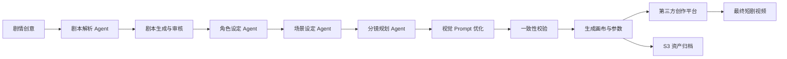
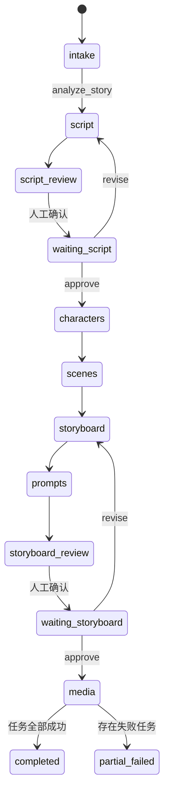

# AI Short Drama Canvas Orchestrator

面向短剧和内容创作场景的 AI 创作编排后端。在原有 Prompt 驱动画布平台基础上，系统将用户输入的剧情创意转换为结构化剧本、角色设定、场景设定、分镜和视觉 Prompt，形成可回填的创作画布，再交由第三方创作平台生成最终视频。

> 本项目的核心产出是结构化创作画布、生成参数和可复用资产，不负责替代第三方平台完成最终视频渲染。

## 目录

- [业务流程](#业务流程)
- [核心功能](#核心功能)
- [工作流设计](#工作流设计)
- [端到端示例](#端到端示例)
- [接口示例](#接口示例)
- [项目结构](#项目结构)
- [技术栈](#技术栈)
- [本地运行](#本地运行)
- [生产化说明](#生产化说明)
- [安全说明](#安全说明)

## 业务流程



典型链路如下：

1. 用户在画布中输入一段剧情创意。
2. 剧本分析 Agent 抽取标题、类型、基调、时长和创作约束。
3. 剧本 Agent 生成结构化剧本，审核节点检查剧情完整性和可执行性。
4. 用户确认或修改剧本后，角色和场景 Agent 生成可复用的角色卡、场景卡。
5. 分镜 Agent 将剧本拆分为镜头，补充景别、镜头运动、动作、对白和时长。
6. Prompt 优化节点结合角色、场景和镜头信息，生成图片/视频/配音所需的参数。
7. 一致性校验节点检查引用 ID、镜头时长、媒体类型、角色和场景约束；异常时只重规划受影响的镜头。
8. 系统将结构化内容、Prompt 和参考资产回填到画布，并交给第三方平台生成最终视频。

## 核心功能

### 1. 多阶段 Agent 工作流

基于 LangGraph 构建有状态工作流，将每个创作阶段拆分为独立节点，并通过条件路由控制流程：

- `story_analyzer`：理解剧情创意并生成 `CreativeBrief`。
- `script_writer`：生成 `ScriptDocument` 和可执行的剧情段落。
- `character_designer`：输出角色卡，维护稳定的角色 ID。
- `scene_designer`：输出场景卡，维护稳定的场景 ID。
- `storyboard_director`：生成镜头序列、景别、镜头运动和对白。
- `visual_prompt_optimizer`：根据角色、场景和镜头上下文生成视觉 Prompt。
- `script_reviewer` / `storyboard_reviewer`：执行结构、可执行性和一致性检查。

### 2. 人工审批与断点恢复

剧本和分镜在进入下游生成前可以暂停等待人工确认。用户可以：

- `approve`：确认当前结果并继续后续节点。
- `revise`：提交修改意见，只重新执行当前阶段。
- `reject`：终止当前创作运行。

工作流状态包含 `brief`、`script`、`characters`、`scenes`、`shots`、`media_task_ids` 等上下文，并通过 Checkpointer 使用 `run_id` 作为线程标识，支持中断后恢复。

### 3. 结构化输出与参数一致性校验

模型调用统一使用 Pydantic 领域模型约束输出，包括：

- `CreativeBrief`：标题、梗概、类型、基调、目标时长和创作要求。
- `ScriptDocument`：版本、标题、梗概、基调、目标时长和剧情段落。
- `CharacterCard`：角色 ID、外观、服装、性格和声音设定。
- `SceneCard`：场景 ID、描述、时间、天气、光线和关键物件。
- `Shot`：镜头 ID、场景 ID、角色 ID、时长、景别、镜头运动和生成 Prompt。

校验内容包括：

- 分镜引用的 `scene_id` 是否存在于场景卡。
- 分镜引用的 `character_ids` 是否存在于角色卡。
- 镜头时长、媒体类型和生成参数是否满足约束。
- 图片 Prompt、视频 Prompt 和配音文本是否按媒体类型完整生成。
- 模型返回 Markdown、外层 `data/result/output` 包装或字段别名时的兼容解析。

### 4. 模型网关与调用观测

模型网关将模型能力与业务 Agent 解耦，支持在管理端配置第三方模型：

- 配置 LLM/VLM/图片/视频/TTS 等能力。
- 按能力和优先级选择模型供应商。
- 使用 OpenAI-Compatible API 统一调用文本模型。
- 检测 API Base URL、模型名称和 API Key 是否可用。
- 记录输入 Token、输出 Token、总 Token、调用延迟和费用。
- 保留 provider、model、capability 和 run_id 维度的调用记录，便于排查和成本分析。

### 5. 异步媒体任务与幂等恢复

当画布进入媒体准备阶段，系统为每个分镜创建独立任务：

- 图片任务：生成角色/场景参考图或画面素材。
- 视频任务：生成交给第三方平台使用的视频参数或视频任务。
- 音频任务：生成配音文本或 TTS 任务参数。

每个任务由 `run_id + shot_id + prompt + media_type + model` 计算幂等键，避免重复调用和重复结算。任务状态包括 `queued`、`running`、`succeeded`、`retryable_failed`、`failed` 和 `canceled`，支持 Celery/RabbitMQ 调度、失败重试、超时补偿和局部恢复。

### 6. 资产归档与画布回填

生成结果通过资产存储抽象层处理：

- 开发环境使用内存资产存储，便于本地演示。
- 生产环境使用 S3 保存图片、视频、音频及参考素材。
- 生成对象按照项目、运行、分镜和任务 ID 组织存储路径。
- 通过预签名 URL 向画布提供临时访问地址。
- 通过 `CanvasBinding` 将 Prompt、资产 ID 和画布节点建立映射。
- 上游剧本、角色或场景发生变化时，将受影响的下游绑定标记为 `stale`。

## 工作流设计



关键状态：

| 状态 | 含义 |
| --- | --- |
| `running` | Agent 正在执行工作流节点 |
| `waiting_user` | 等待用户审批或提交修改意见 |
| `generating_media` | 画布已生成，异步媒体任务执行中 |
| `completed` | 所有任务完成并已回填画布 |
| `partial_failed` | 部分媒体任务失败，可按分镜重试 |
| `failed` | 工作流级异常，需要查看错误事件 |

## 端到端示例

### 输入剧情创意

```text
雨夜，一名外卖员在旧城区收到一封没有寄件人的信，信里写着明天将发生的事情。
他按照线索寻找寄信人，最后在废弃电影院遇到一个和自己长得一模一样的人。
请生成一段 30 秒悬疑短剧，节奏紧凑，结尾保留反转空间。
```

### 剧本 Agent 输出

```json
{
  "version": 1,
  "title": "午夜来信",
  "logline": "外卖员在雨夜收到预言信，并在废弃电影院遇到另一个自己。",
  "tone": "写实悬疑、冷色电影感",
  "target_duration_seconds": 30,
  "beats": [
    {
      "id": "beat_01",
      "location": "旧城区巷口",
      "time": "深夜",
      "action": "外卖员在雨中发现一封没有寄件人的信。",
      "dialogue": []
    },
    {
      "id": "beat_02",
      "location": "废弃电影院",
      "time": "深夜",
      "action": "他沿着信中的线索进入电影院，银幕突然亮起。",
      "dialogue": ["你终于来了。"]
    }
  ]
}
```

### 画布分镜输出

```json
{
  "id": "shot_02",
  "sequence": 2,
  "scene_id": "scene_abandoned_cinema",
  "character_ids": ["character_delivery_rider"],
  "duration_seconds": 7,
  "shot_size": "中近景",
  "camera_motion": "沿走廊缓慢推进",
  "action": "外卖员推开电影院大厅的门，远处银幕亮起。",
  "dialogue": "你终于来了。",
  "image_prompt": "雨夜废弃电影院大厅，外卖员湿透的黄色雨衣，冷蓝色光线，银幕发出微弱白光，写实电影感，中近景",
  "video_prompt": "镜头沿走廊缓慢推进，外卖员推门后停住，银幕逐渐亮起，时长 7 秒，保持角色服装和场景光线一致",
  "voice_text": "你终于来了。"
}
```

该分镜会被回填到画布节点，并产生对应的图片、视频和配音任务。第三方创作平台读取 `scene_id`、`character_ids`、Prompt、时长和参考资产后，继续完成最终视频生成。

## 接口示例

### 创建项目

```bash
curl -X POST http://127.0.0.1:8000/api/projects \
  -H "Content-Type: application/json" \
  -d '{"name":"午夜来信","canvas_id":"canvas_demo_001"}'
```

### 创建创作运行

```bash
curl -X POST http://127.0.0.1:8000/api/projects/project_xxx/runs \
  -H "Content-Type: application/json" \
  -d '{
    "prompt":"雨夜外卖员收到预言信，并在废弃电影院遇到另一个自己。",
    "auto_approve":false
  }'
```

接口会立即返回 `run_id`。客户端可以轮询运行状态，或通过 WebSocket 接收 Agent 完成、人工审批、任务排队、资产回填和异常事件。

### 审批剧本

```bash
curl -X POST http://127.0.0.1:8000/api/runs/run_xxx/approve \
  -H "Content-Type: application/json" \
  -d '{"action":"approve"}'
```

### 请求修改

```bash
curl -X POST http://127.0.0.1:8000/api/runs/run_xxx/approve \
  -H "Content-Type: application/json" \
  -d '{
    "action":"revise",
    "feedback":"将结尾改为开放式反转，并增加电影院中的环境音提示。"
  }'
```

### 查询运行详情和用量

```bash
curl http://127.0.0.1:8000/api/runs/run_xxx
curl "http://127.0.0.1:8000/api/admin/usage?run_id=run_xxx"
```

## 模型网关配置示例

模型 API Key 通过管理接口写入，服务端只保存加密值并返回脱敏信息：

```bash
curl -X POST http://127.0.0.1:8000/api/admin/model-providers \
  -H "Content-Type: application/json" \
  -d '{
    "name":"deepseek-main",
    "provider_type":"openai_compatible",
    "api_base":"https://api.deepseek.com",
    "model_name":"deepseek-chat",
    "capabilities":["llm"],
    "api_key":"YOUR_API_KEY"
  }'
```

如需为某项能力指定模型，可额外创建模型路由：

```bash
curl -X POST http://127.0.0.1:8000/api/admin/model-routes \
  -H "Content-Type: application/json" \
  -d '{
    "capability":"llm",
    "provider_id":"provider_xxx",
    "model_name":"deepseek-chat"
  }'
```

## 项目结构

```text
app/
  api.py              REST API、WebSocket 事件推送
  graph.py            LangGraph 状态图与条件路由
  domain.py           领域模型和工作流状态
  routed_gateway.py   结构化模型调用与输出校验
  gateway_admin.py    模型供应商、路由和用量管理
  services.py         运行编排、媒体任务和画布回填
  providers.py        模型、资产存储和媒体适配器
  repositories.py     仓储抽象（本地演示使用内存实现）
  tasks.py            Celery 任务入口
  static/             本地演示页面
```

## 技术栈

Python、FastAPI、LangGraph、LangChain Core、Pydantic、Celery、RabbitMQ、AWS S3、WebSocket、HTTPX、OpenAI-Compatible API。

生产环境可将仓储层替换为 PostgreSQL，并使用 PostgreSQL Checkpointer 保存跨实例的工作流状态。

## 本地运行

```powershell
python -m venv .venv
.\.venv\Scripts\Activate.ps1
pip install -r requirements.txt
uvicorn app.main:app --reload
```

启动后访问：

- `http://127.0.0.1:8000/`：本地演示页面。
- `http://127.0.0.1:8000/docs`：FastAPI OpenAPI 文档。
- `http://127.0.0.1:8000/health`：服务健康检查。

复制 `.env.example` 为 `.env` 后，可配置 RabbitMQ、S3 和模型网关加密密钥。开发环境默认使用内存仓储、内存资产存储和模拟模型；设置 `APP_ENV=production` 后可切换 S3 资产存储。

## 主要接口

```text
POST /api/projects
POST /api/projects/{project_id}/runs
GET  /api/runs/{run_id}
POST /api/runs/{run_id}/approve
POST /api/runs/{run_id}/cancel
POST /api/runs/{run_id}/shots/{shot_id}/retry
GET  /api/runs/{run_id}/events
WS   /api/ws/runs/{run_id}

POST /api/admin/model-providers
GET  /api/admin/model-providers
POST /api/admin/model-providers/{provider_id}/test
POST /api/admin/model-routes
GET  /api/admin/usage
```

## 生产化说明

- 当前仓储默认是线程安全的内存实现，用于演示工作流和 API；多实例部署时应替换为 PostgreSQL 仓储。
- 当前媒体 Provider 提供适配器接口和本地模拟实现，真实的图片、视频和 TTS 服务可通过模型网关接入。
- 启用 Celery 时设置 `USE_CELERY=true` 并配置 `RABBITMQ_URL`，Worker 使用 `app.tasks.generate_media_task` 执行媒体任务；默认使用 RabbitMQ RPC 结果后端。
- 生产环境建议将 API、Worker、RabbitMQ、PostgreSQL、S3 和模型网关拆分部署，并为 WebSocket 和任务事件配置统一的事件总线。

## 安全说明

模型 API Key 只保存加密后的值，接口返回时仅展示脱敏信息；`.env`、缓存文件和 Python 字节码均通过 `.gitignore` 排除，不应将真实密钥提交到仓库。
